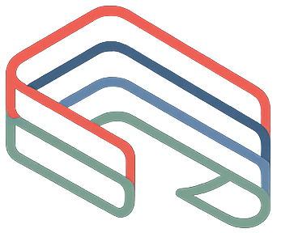

<p align="center">
  
</p>

# Cascade: synthetic data, real forecasting tests

**The ambition is a model that sees the future.** Cascade is a Bittensor
subnet (netuid 91) where miners compete to make a shared time-series
forecaster better: with synthetic training data, expert updates, fine-tuning
recipes or their own trained weights. Every entry is judged on real series it
could not have trained on. The [competition introduction](agent.md) explains
the idea and links the historical evidence.

**Status.** Lanes B, C and D open at block **9586800** (about Wed
2026-11-25 22:28 UTC), and **lane A closes to new challengers at the same
block**. From then the intake refuses new lane A funds (`409 lane_ended`),
lane A king checks and promotions stop, and the lane A king (uid 164) is frozen
as the reference model for lanes B and D. The signed step 1 launch overlay sets
the split to **A 50% / B 35% / C 15%**. A second signed overlay arms lane D (at
9586800 if it locks in, otherwise at a later era start) and moves the split to
**A 0% / B 35% / C 15% / D 50%**. D's 50% stays with the lane A king until the first miner is crowned lane D king. `cascade rules a|b|c|d`
prints a lane's rules from `chain.toml`; `cascade status --json` shows what
is live now.

## Competitions

Each lane has a one-page brief: intent, what you submit, how it is scored and
paid (with a worked example), commands, strategies, costs, refusals and a FAQ.

| Lane | You compete with | Brief |
|---|---|---|
| A | A synthetic-data generator; the model and recipe are fixed | [MINER_LANE_A.md](docs/MINER_LANE_A.md) |
| B | A generator that trains a few experts for a domain, horizon or benchmark suite | [MINER_LANE_B.md](docs/MINER_LANE_B.md) |
| C | A MarketCast fine-tuning recipe for the pinned Timestral base | [MINER_LANE_C_MARKETCAST.md](docs/MINER_LANE_C_MARKETCAST.md) |
| D | Open weights: a `cascade_pyramid` checkpoint you trained anywhere | [MINER_LANE_D.md](docs/MINER_LANE_D.md), reference [LANE_D.md](docs/LANE_D.md) |

### Rules at a glance

| Lane | To win | What a win earns |
|---|---|---|
| A | **Closed to new challengers from block 9586800.** Before that: your gain LCB over the king had to clear the dethrone margin (0.10, decaying to 0.01 with tenure), then pass the GIFT-Eval/BOOM/TIME/FEV bench gate | The frozen king keeps its ladder share of A's pool while A has one; it is the house in lane D and the reference model for lane B |
| B | Clear a slot: CRPS or MASE gain LCB ≥ 1% on a declared target (2% on any other slot), the other metric non-inferior, no guard regressing; then pass merge acceptance | Each accepted slot pays 3.5% in full every settlement until a newer leg replaces it. Acceptance needs a new shared init, which opens only at a lane A promotion, so under the launch config no B slot is paid yet (see [rewards](#rewards)) |
| C | Beat the pinned Timestral base on embargo-period market windows (composite gain LCB ≥ 1%), pass the calibration and baseline guards, then confirm and beat the slot holder | The MarketCast slot at full pay for 5–20 days, scaled by the confirmed gain |
| D | Beat both the lane D king and the house (lane A king) by the crown bar (3%, decaying to 1% over 32 settlements) on forward-only windows, and pass the drawn bench gate. Embargo 24 h at launch; the public-half weight is set by overlay (currently live-only) | The king seat of an 80/15/5 court; prior kings stay paid with no time limit. Until the first crown, D's 50% stays with the lane A king |

One hotkey holds one chain commitment across lanes and at most one live
training leg. Funding makes an entry eligible; it never guarantees a reward.

## Start here

| You are | Read |
|---|---|
| A new miner | [Miner guide](docs/MINER.md#quickstart), then your lane's brief above |
| Writing a generator | [Submission interface](docs/INTERFACE.md) and [multichannel generators](docs/MINER.md#11-multichannel-generators) |
| A MarketCast recipe author | [MarketCast reference](docs/MARKETCAST.md) |
| A coding agent | [AGENTS.md](AGENTS.md) and [the agent walkthrough](docs/AGENT_MINING.md) |
| A validator | [Validator guide](docs/VALIDATOR.md) |
| Reviewing the design | [Architecture](docs/ARCHITECTURE.md), [model and recipe](docs/MODEL.md) and [decisions](decisions/) |
| Looking for any other doc | [The docs map](docs/README.md) |

The live model is **Cascade MoE Base - 1.23B** (a pyramid mixture of experts,
112M active parameters per token). Smaller presets (17.58M, 69.02M, 273.84M)
are for cheap local experiments; see [presets](deploy/presets/README.md).
For local scoring use the public eval pool
[Tensor-Link/cascade-eval-pool](https://huggingface.co/datasets/Tensor-Link/cascade-eval-pool),
an evaluation set and never training data
([details](docs/MINER.md#held-out-data-the-public-eval-pool)).

## Rewards

The numbers below are the **checked-in template** (lanes A, B and C, before
any overlay). On mainnet the launch overlay replaces the shares with
A 0 / B 35 / C 15 / D 50 at block 9586800; each lane brief works its example
at that split. The [complete reward schedule](docs/MINER.md#rewards-allocation-burn-and-progression)
has every rule and a worked allocation.

<!-- cascade:rewards:summary:start -->
These are the live mainnet rules from the launch at block 9,586,800 (about 2026-11-25 22:27 UTC): the checked-in `chain.toml` plus the launch overlays `deploy/overlays/launch-20261125.pre.mainnet.toml` (step 1) and `launch-20261125.mainnet.toml` (step 2). A later signed overlay can change them; check `cascade status --json` and the signed reward records before submitting.
Percentages are shares of total emissions. A lane's pool is its budget; miners receive only the shares they earn, and the rest burns.

| From block 9,586,800 | A pool | B pool | C pool | D pool |
|---|---:|---:|---:|---:|
| Step 1 (overlay cfg-961291bc, lanes B and C) | 50% | 35% | 15% | 0% |
| Step 2 (second overlay, lane D armed) | 0% | 35% | 15% | 50% |

- **Lane A is closed to new challengers from block 9,586,800.** The intake refuses a new lane A fund or funded submit (`409 lane_ended`) and the trainer seats no new challenger. King checks and promotions are off (`[v2] reign_warm_start_blocks = 0`), so the lane A king is frozen as the reference model for lanes B and D. In step 1, A's pool pays that king its ladder share, which no longer changes; the rest of A burns.
- **Lane D:** step 2 arms lane D at 9,586,800 if its overlay locks in by then, otherwise at a later era start. D takes its 50% from lane A. At lane D genesis the house entry (the frozen lane A king) holds the lane D throne and D's share stays with the lane A king until the first miner is crowned lane D king. Then D's pool pays its court 80/15/5 (king, then the two previous kings). The crown bar is a 3% LCB falling linearly to 1% over 32 settlements. The embargo is 24 h at launch and the public-half weight is set by overlay (currently 0, live-only: no public index is scored).
- **B winner:** the 10 slots each pay 3.5% of total emissions to their holder every settlement, with no decay or expiry, until a newer leg's accepted merge takes the slot. Qualification is unpaid: pay starts only when a qualified expert is accepted into a shared era init, and the code opens a new init only at a lane A promotion. With lane A promotions off, **no lane B slot is paid under the launch config**; qualified experts wait as pending until the owner changes this. Every leg is tested on every slot: up to 4 declared targets clear at a 1% gain LCB, any other slot at 2%; one miner may hold every slot.
- **B timing:** a finished leg typically settles about one settlement (3 h) after it finishes: its public bench is queued at the first settlement and the leg is judged once the bench rows exist.
- **C winner:** an initial test pass is unpaid. A later confirmation must win the target slot. C's pool is divided by competition weight, then target count. The current sole competition, MarketCast, has 1 target: each full-pay slot is 15% of total emissions.
- **C full-pay duration:** MarketCast C: 5 days (10 eras) at LCB 0.01, rising linearly to 20 days (40 eras) at LCB ≥ 0.05. C uses confirmed gain; each win keeps its recorded duration. B has no tiers.
- **C progression:** C has no decay: its slot ends when the full-pay duration ends. Age starts at C confirmation. A new holder stops the old holder's pay.
- **Burn:** unpaid A, empty B slots, empty/ended C slots and inactive competition allocations go to `burn_uid`; they are not shared among other miners. An unlaunched lane has no reserved pool.
- **Check payment:** read signed reward records and on-chain weights. Queue completion, qualification and pending confirmation are not paid wins. Public status reports `reward_status=not_verified` because it does not verify payment.
<!-- cascade:rewards:summary:end -->

## Commands

Start with `cascade --help`. Every command has `--help` and `--json`. Local
and read-only commands never rent a GPU; paid actions refuse without `--yes`.

| Command | Purpose |
|---|---|
| `cascade rules`, `cascade status` | A lane's rules; what is live now |
| `cascade init`, `verify`, `preflight` | Starter source, local validation, a read-only submission proposal |
| `cascade iterate`, `score` | Local model experiments |
| `cascade submit`, `deploy`, `fund` | Lane A submission and funding (lane A is closed to new challengers from block 9586800; `deploy --expert-domain` is lane B) |
| `cascade lane-b`, `lane-c`, `lane-d` | Lane B, C and D tests, uploads, commits and funding |
| `cascade round`, `queue`, `duel`, `reveal-status`, `fetch` | Clock, roster, verdicts, reveal checks and public artifacts |

Lanes A–C rent training on your own provider key (Lium, Shadeform, Vast.ai
or Runpod; Lium is the default), supplied through the environment. See
[provider keys](docs/MINER.md#compute-provider-keys). Lane D needs no key.
The JSON envelope and exit codes are in [AGENTS.md](AGENTS.md#output-contract).

## Development

Use uv >=0.13.4 and a patched OS CA store; the locks require certifi
>=2026.10.19 ([TLS setup](docs/OPERATOR.md#tls-trust-and-the-october-2026-emudhra-incident)).

```bash
uv sync --frozen --all-extras
uv run --frozen python scripts/check_tls_trust.py
uv run pytest tests -q
uv run ruff check cascade benchmarks/cascade_benchmark scripts
uv run python scripts/check_docs.py
git diff --check
```

`scripts/check_docs.py` checks CLI examples, links, the configuration
reference and the reward tables against the code. It does not prove that a
deployment is live. Operator services (`cascade-trainer`, `cascade-validator`,
`cascade-satellite`, `cascade-audit` and others) are covered in the
[validator guide](docs/VALIDATOR.md); the
code layout is in [ARCHITECTURE.md](docs/ARCHITECTURE.md).

## License

MIT
