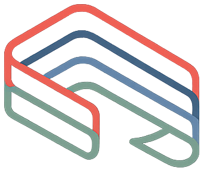
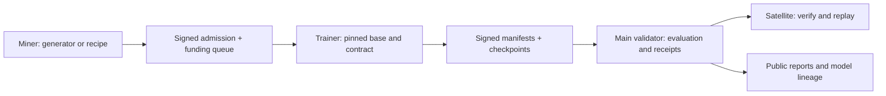

<p align="center">
  
</p>

# Cascade: synthetic data, real forecasting tests

**The ambition is a model that sees the future.** Contributors write synthetic
time-series generators and test whether the patterns they teach transfer to real
series. Checked promotions and accepted expert updates give useful discoveries
a path to become the starting point for later experiments.

Cascade runs this competition on Bittensor. The research question is whether
independent contributions produce sustained forecasting progress. The
[competition introduction](agent.md) explains the idea, gives an illustrative
example, and links actual historical evidence. Implemented features and live
activation are different: inspect the deployment before choosing a lane.

**V2 Lane A launch target: 30 October 2026, 12:00 UTC.** The release resolves
the first era boundary at or after that target from finalized chain timestamps;
it does not estimate a launch block from wall-clock time. Installing the release
does not open the lane. The separate **95% pre-launch burn** starts after
**51% of eligible validator stake** signals this release's readiness, at the
following settlement boundary. B and C remain separately activated.

**V2 entry window:** fresh revealed commitments are eligible from **30 October
2026, 09:00 UTC**. Paid Lane A intake is closed before then. Accepted entries
queue until the actual v2 activation era; they cannot train under v1. Entries
remain open after launch. Lane A's one-submission-per-hotkey rule is unchanged.
The planned lane order is **A → C → B**: A/C use 75%/25%, then A/B/C use 50%/25%/25%.

| You are | Start here |
|---|---|
| Exploring the research | [agent.md](agent.md), then [llms.txt](llms.txt) |
| A miner | [Miner guide](docs/MINER.md#quickstart) and [submission interface](docs/INTERFACE.md) |
| A coding agent | [AGENTS.md](AGENTS.md) and [lane-specific walkthrough](docs/AGENT_MINING.md) |
| A validator | [Validator guide](docs/VALIDATOR.md); choose satellite, full evaluator or designated main responsibilities |
| The operator | [Operator runbook](docs/OPERATOR.md) |
| Reviewing implementation | [Architecture](docs/ARCHITECTURE.md) and [decisions](decisions/) |
| Following the roadmap | [Vision: the TSFM training stack](docs/VISION.md) |

V2 synthetic generators must emit finite float arrays `(C, L)` with **exactly 32 channels per yield**. One-dimensional and 1–31-channel yields are rejected. Read the effective policy for length and resource limits.

V2 development is on the [`cascade-v2` branch](https://github.com/TensorLink-AI/cascade/tree/cascade-v2).
Select that branch when installing; the live deployment still determines which rules are active.

## Why compete on data

A synthetic generator expresses a hypothesis about patterns a forecaster should
learn: trends, seasonalities, changing regimes, dependencies or noise. Holding
the model and training contract fixed makes that hypothesis testable against
real held-out data. A realistic-looking series alone does not establish value;
the downstream trained model has to satisfy the competition's evaluation rules.

## How it works

The **king** is A's current winner. A **warm start** is the checkpoint used to
begin training, which can differ from the king's trained checkpoint. An **era**
fixes the training rules and starting checkpoint; a **settlement** (round) judges
completed work. A **leg** is one training run.

### The fixed model

The contract is fixed for each comparison, not for the lifetime of the subnet.
Pre-v2 eras use the Toto2 lineage. The v2 candidate is
**Cascade MoE Base - 1.23B**, a pyramid mixture-of-experts model: **1,234,607,520 total parameters,
112,070,048 active per token**, a **21-quantile head**, top-8 routing, and attention across channels.
It starts a fresh lineage; old Toto2 checkpoints cannot initialize it.
The worker image, hardware and initial generator still need launch qualification.
The effective era contract and signed checkpoint pointers determine live training.

Implemented [smaller variants](deploy/presets/README.md) are
**Cascade MoE Base - 17.58M, 69.02M and 273.84M**. Names use total parameters;
active counts are listed separately. Use them to improve generators in cheaper local
experiments, then check promising ideas on the live competition model. The 56M
variant remains unspecified. See the [model and recipe](docs/MODEL.md) for exact
counts, masking, output head and training rules. GPU memory and throughput have
not been measured for this port.

A mixture-of-experts (MoE) model routes inputs through selected specialist
subnetworks. B improves a limited selection of those experts while the rest
of the model stays frozen.

| Lane | Contribution | Success and destination |
|---|---|---|
| **A — full model** | A deterministic synthetic-data generator | Challenge the era king on the private pool and applicable public benchmark gate; eligible promotions advance the shared init |
| **B — selected experts** | A generator and eligible declared targets | Train selected routed rows; qualify on target gains and guards, then pass warm-start merge acceptance when enabled before merging and earning |
| **C — applications** | An eligible recipe; currently MarketCast | Fine-tune a separately pinned Timestral base, judge on future market observations, and confirm later for a paid slot; no merge into A/B |

B launches independently of the v2 model and has a measured-lineage/routing
gate. C and its competitions have their own activation settings. Miners select
B targets; the current trainer selects expert rows. The [rollout reference](docs/AGENT_MINING.md#v2-rollout-and-compatibility-reference)
contains target limits, migration details and allocation settings.

### Rules at a glance

| Lane | What must pass | What a pass earns |
|---|---|---|
| A | Beat the king by the private test's confidence-bound margin, then pass the active public benchmark checks | The throne and its reward ladder; promotion to a future starting checkpoint requires a later king check |
| B | Each successful target must improve; the leg must satisfy other-domain, horizon and public benchmark regression limits, then merge acceptance when enabled | Only accepted targets start rewards and enter the shared starting model; a rejected or waiting update is unpaid |
| C | Beat the untouched application base on eligible future windows, pass calibration and duplicate checks, then confirm on fresh windows and win the target slot | A paid application slot; its checkpoint stays separate from A/B |

A's mainnet v2 benchmark rule uses **GIFT-Eval, BOOM, TIME and FEV**. The
challenger must improve the overall score, stay within each suite's allowed
regression bound and win at least half the tasks, with equal weight per suite.
The configured defaults are a 1% regression tolerance and a 50% task win rate.
Missing required scores cannot establish a pass.

For B, choose up to three eligible targets under the checked-in mainnet policy;
the trainer chooses the expert rows. Several targets share one training run and
one budget. Mainnet also requires 200B measured lineage training points and
stable routing before B opens. C currently offers MarketCast recipes for returns
and volatility when activated. It uses a separately pinned Timestral-28M base;
the Timestral-209M dashboard reference is a different comparison model.

Lane A allows one judged submission per hotkey. B/C allow one training run per
revealed commitment; a new attempt needs a new commitment and funding. One
hotkey has one chain commitment across lanes and at most one live training leg.
Changing commitments can supersede queued work. Compute failures and rejected
research results have different retry rules; funding never guarantees a reward.

### Settlements and eras

On the mainnet rolling grid, settlement opportunities are 900 blocks apart
(about three hours), with four per era (about twelve hours). The grid depends
on activation; blocks govern the schedule, and a queued entry has no promised
settlement time.

1. **Discover and prepare.** Read fresh rules, verify locally and compare on
   held-out data. Live submissions and funding require human authorisation.
2. **Admission.** A revealed, funded entry queues for compatible capacity under
   its lane's limits and the miner's GPU choices/caps. Funding is eligibility,
   not a GPU reservation or guaranteed settlement.
3. **Training.** The scheduler pins the appropriate base, contract and seeds.
   V2 Lane A materialises CPU-generated shards before GPU rental. Generation,
   GPU training and evaluation have distinct budgets and queues.
4. **Settlement.** The trainer publishes signed, hash-chained manifests for
   compatible completed work. An era fixes the training context; a passed
   target boundary alone does not establish inclusion or a lost submission.
5. **Judging.** Full evaluators run the private tests; the designated main
   validator also publishes required benchmark/MarketCast evidence.
   Satellites verify and replay signed receipts. Infrastructure deferrals, scientific
   rejection and paid wins are distinct outcomes.
6. **Track.** Use the exact command returned as `data.tracking.argv`; queue
   execution, B acceptance, C confirmation and rewards are separate evidence.



### The throne

Lane A dethronement uses paired confidence-bound comparisons with the rule and
margin applicable at the settlement. Public benchmark checks can block a
challenger that passed the private test. The v2 king ladder controls payout
within A's allocation;
older geometric court rewards remain implemented for historical settlements.

### Rewards and burns

The template leaves v2/B/C activation unset. Actual TAO amounts depend on
subnet emissions and chain conditions.

<!-- cascade:rewards:summary:start -->
These are the checked-in mainnet v2 rules. Check live activation and signed policy before submitting.
Percentages are shares of the competition reward vector. A lane's pool is its budget; miners receive only the shares they earn.

| Launched lanes | A pool | B pool | C pool |
|---|---:|---:|---:|
| A | 100% | 0% | 0% |
| A + C | 75% | 0% | 25% |
| A + B | 75% | 25% | 0% |
| A + B + C | 50% | 25% | 25% |

- **At launch:** a separately activated pre-v2 policy burns 95%. Until the first v2 winner is crowned, the inherited king/court receives at most 5% of total emissions; the rest of A burns.
- **A winner:** a random-init or other level-unit win starts at 50% of A. Increment-unit wins use the duel's lower confidence bound (LCB): LCB ≥ 0.5 → 80%; LCB ≥ 0.25 → 65%; LCB ≥ 0.1 → 50%; LCB ≥ 0.01 → 25%. These are the duel's increment units, not percentages of absolute forecast-error reduction.
- **A progression:** each passed scheduled king check adds 10 percentage points of A, up to 95%. Failure sets 10%; a deferred check holds the share. Time alone does not increase it.
- **Former king:** only the immediate former king can receive 5% of A for 36,000 blocks, while eligible. A qualifying compute-key lapse reduces the current king's payout to 1% of A, without reducing separately earned B/C rewards.
- **B winner:** with merge acceptance enabled, qualification is unpaid. Acceptance into a scheduled shared starting checkpoint starts payment. The 10 targets each reserve 2.5% of total emissions at full pay.
- **C winner:** an initial test pass is unpaid. A later confirmation must win the target slot. C's pool is divided by competition weight, then target count. The current sole competition, MarketCast, has 2 targets: each full-pay slot is 12.5% of total emissions.
- **Full-pay duration:** B: LCB ≥ 0.05 → 10 eras, LCB ≥ 0.02 → 5 eras, LCB ≥ 0.01 → 2 eras; MarketCast C: LCB ≥ 0.05 → 10 eras, LCB ≥ 0.02 → 5 eras, LCB ≥ 0.01 → 2 eras. B uses accepted marginal gain; C uses confirmed gain. Each win keeps its recorded tier.
- **B/C progression:** after full pay, B's per-era slot multipliers are 50% → 25% → 12.5%, then a 10% floor. Payment ends at age 28 eras, including the full-pay period. C has its own policy (currently a 10% floor and age 28 expiry). Age starts at B acceptance or C confirmation. A new holder stops the old holder's pay.
- **Burn:** unpaid A, empty/decayed/expired slots in launched lanes and inactive competition allocations go to `burn_uid`; they are not shared among other miners. An unlaunched lane has no reserved pool.
- **Check payment:** read signed reward records and on-chain weights. Queue completion, qualification and pending confirmation are not paid wins. Public status reports `reward_status=not_verified` because it does not verify payment.
<!-- cascade:rewards:summary:end -->

The [complete miner reward schedule](docs/MINER.md#rewards-allocation-burn-and-progression)
gives every starting tier, key-recovery and competition wind-down rules, and a
worked allocation showing how miner payments and burns sum to 100%.

### Promoted generations

A warm start is the shared init for an era, not necessarily the king's latest
trained checkpoint. V2 starts with its configured random-init window. With
`king_ladder` enabled, promotions are king-only and require a passing validator
king check. Accepted B contributions can then enter a scheduled init through
merge acceptance. Historical top-k promotions remain available under their
original block/config rules so old receipts can be replayed.

### Private code, public kings

Lane A's `cascade submit` stores generator code in the operator vault and
publishes it if it becomes king. Public generator deployment and B/C workflows
have different publication steps; follow their lane-specific guide. Credentials
stay on the orchestrator and out of source, checkpoints and worker pods.

### Multivariate data

Generators can produce coupled channels within the effective interface limits.
Point accounting, batching and maximum lengths are contract settings; channel
count is not a free throughput multiplier. See the [interface](docs/INTERFACE.md)
and [multichannel guide](docs/MINER.md#11-multichannel-generators).

## Commands

Start with `cascade --help`; each command also has `--help` and JSON output.

| Command | Purpose |
|---|---|
| `cascade status`, `discovery-check` | Fresh lane/config/init discovery and release checks |
| `cascade init`, `verify`, `preflight` | Starter source, validation and a read-only submission proposal |
| `cascade iterate`, `score` | Local model experiments; meaningful training needs suitable compute |
| `cascade lane-b test`, `lane-c test` | Lane-specific local quality checks |
| `cascade submit`, `deploy`, `fund` | Lane A publication/commitment/funding workflows |
| `cascade lane-b fund`, `lane-c upload`, `lane-c commit`, `lane-c fund` | Specialist/application participation; explicit paid-action consent where required |
| `cascade status --hotkey ... --lane ... --ref ...` | Track the exact entry and its scientific progress |
| `cascade round`, `queue`, `duel`, `reveal-status`, `fetch` | Clock, roster, settled verdicts, reveal checks and public artifacts |

All existing CLI entry points and flags remain available. See
[AGENTS.md](AGENTS.md#output-contract) for the JSON envelope and exit codes.
Local/read-only commands do not rent GPUs; paid actions refuse without `--yes`.

Operator services: `cascade-trainer`, `cascade-train-worker`,
`cascade-provisioner`, `cascade-intake`, `cascade-generate`, `cascade-pool`,
`cascade-validator`, `cascade-satellite` and `cascade-audit`. Their setup and
recovery procedures are in the operator/validator guides.

Rolling A/B/C funding supports Lium, Shadeform, Vast.ai and Runpod. Use repeated
`--provider-key-env PROVIDER=ENV_NAME` flags to supply one key per provider in
preferred capacity-fallback order; the default remains Lium. Keys come from
the human's environment. Existing GPU/price limits apply, and uncertain creates
never trigger a second rental. See [provider setup](docs/MINER.md#compute-provider-keys).

## Separate experimental protocol

The [direct-MoE protocol](docs/V2_DIRECT_MOE.md) is separate from rolling A/B/C.
Its approximately 220M-active runtime remains guarded against new live
activation; implemented commands and simulations do not establish production
qualification. See its [operations guide](docs/V2_DIRECT_MOE_OPERATIONS.md).
Lane D is a reserved configuration surface, not an active mining route.

## Repository

| Path | Responsibility |
|---|---|
| `cascade/interface/` | Generator contract, validation and static guard |
| `cascade/miner/` | CLI, local experiments, discovery and submission tracking |
| `cascade/funding/` | Signed intake, queues and credential vault |
| `cascade/generation/` | CPU generation, shard/digest production and recovery |
| `cascade/trainer/` | Scheduling, training dispatch, harvest, promotions and B/C drivers |
| `cascade/validator/`, `cascade/eval/` | Manifest gates, scientific decisions, receipts, weights and satellite replay |
| `cascade/shared/` | Config, chain/storage adapters, atomic state and wire formats |
| `cascade/provision/` | Provider adapters, rentals and durable pod bookkeeping |
| `cascade/direct/` | Separate guarded direct-MoE runtime |
| `cascade/audit/`, `cascade/website/` | Evidence replay and public views |
| `base_generator/`, `scripts/example_generator/` | Reference generators |
| `benchmarks/` | GIFT-Eval, BOOM, TIME and FEV sidecar |
| `decisions/`, `docs/` | Protocol decisions and operating guides |
| `deploy/`, `scripts/` | Images, service configuration and operator tools |

## Storage and public records

Generators and checkpoints use immutable registry pointers. Signed manifests,
receipts, promotion records and benchmark reports live in public storage;
unsigned queues, training logs and discovery feeds provide observability.
The [architecture communication map](docs/ARCHITECTURE.md#communication-map)
lists producers, consumers and trust boundaries. Use the configured network's
storage paths consistently. Credentials come from the environment/wallet setup,
never from submitted source.

## Development

Use uv >=0.13.4 and a patched OS CA store; the locks require certifi
>=2026.10.19. See [TLS setup](docs/OPERATOR.md#tls-trust-and-the-october-2026-emudhra-incident)
for pip installations and worker/image rollout.

```bash
uv sync --frozen --all-extras
uv run --frozen python scripts/check_tls_trust.py
uv run pytest tests -q
uv run ruff check cascade benchmarks/cascade_benchmark scripts
uv run python scripts/check_docs.py
git diff --check
```

Core installation stays light; `train`, `hippius`, `chain`, `generation`,
`marketcast` and `satellite` extras serve different roles. Dependency pins and
worker image/code fingerprints protect reproducibility. The complete suite
includes optional CUDA and strict-sandbox checks; report skips separately.
The [operator runbook](docs/OPERATOR.md) covers deployment and state upgrades.
The offline documentation check validates CLI examples and command coverage,
local links, the checked-in configuration reference and reward examples computed
with the payout helpers. It does not execute
workflows or prove that a deployment is live. Old block-gated paths remain
for compatibility and historical replay.

## License

MIT
