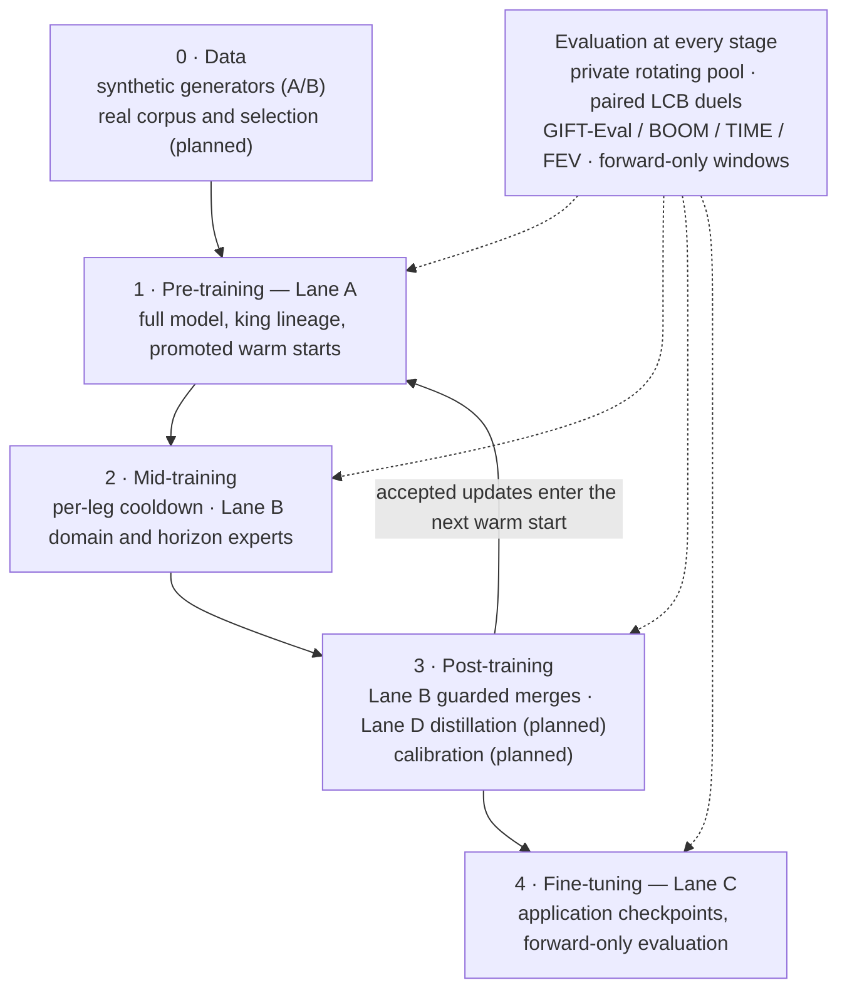

# Vision: a decentralised training stack for time-series foundation models

> **Living document.** This page describes where Cascade is heading and how the
> current implementation lays the foundation. It is updated as stages ship.
> It is not a statement of live activation: read `cascade status --json` and
> the effective configuration before acting on any lane. Protocol rules live
> in [decisions/](../decisions/); rewards live in the
> [miner guide](MINER.md#rewards-allocation-burn-and-progression).

## North star

Frontier time-series foundation models (TSFMs) such as Chronos, TimesFM, Toto
and Moirai are built by a single lab running a full training stack: data,
pre-training, mid-training, post-training and fine-tuning, each with its own
evaluation. Cascade's aim is to run **that whole stack as an open
competition**: every stage is a lane where independent contributors propose
an input (data, a recipe or a teacher), the operator trains under a fixed
contract on miner-funded compute, and validators accept only measured,
signed improvements.

Each accepted improvement becomes the starting point for the next stage and
the next era. That compounding is the meaning of the name Cascade.

## The stack

## Stage by stage

| Stage | What a frontier lab does | Cascade lane | Foundation in place today | Next step |
|---|---|---|---|---|
| **0. Data** | Synthetic priors (kernel/GP mixtures), large real corpora, augmentation such as TSMixup | Lane A/B generators; Lane D data selection | Deterministic, sandboxed 32-channel generators ([interface](INTERFACE.md)); CPU shard generation tier ([DEC-CA-0053](../decisions/DEC-CA-0053-cpu-generation-tier.md)); content dedup ([DEC-CA-0008](../decisions/DEC-CA-0008-content-dedup.md)); shared real-corpus machinery shipped inert ([DEC-CA-0028](../decisions/DEC-CA-0028-shared-real-corpus.md)) | Pin a real corpus disjoint from every evaluation pool and arm it, so pre-training uses a real + synthetic mix |
| **1. Pre-training** | One long run from random init on a fixed architecture | **Lane A** | Cascade MoE Base - 1.23B ([model](MODEL.md)); a random-init window, then a king lineage whose promoted checkpoints become each era's warm start; warmup-stable-decay schedule ([DEC-CA-0018](../decisions/DEC-CA-0018-wsd-schedule-optimizer-continuity.md)); paired confidence-bound duels plus the four-suite public gate ([DEC-CA-0061](../decisions/DEC-CA-0061-lane-a-four-suite-strict-gate.md)); miner-funded compute ([DEC-CA-0036](../decisions/DEC-CA-0036-miner-funded-elastic-rounds.md)) | Launch v2 Lane A; measure lineage progress on public benchmarks era over era |
| **2. Mid-training** | Cooldown on high-quality data, domain upweighting, long-context extension | Leg cooldown; **Lane B**; Lane D context | Every v2 leg ends with a linear cooldown, so scored checkpoints are in finished form ([model](MODEL.md#optimizer-and-schedule), lineage rationale in [DEC-CA-0029](../decisions/DEC-CA-0029-fork-anneal-finished-form-checkpoints.md)); Lane B continues training selected experts on declared domains and horizons ([DEC-CA-0050](../decisions/DEC-CA-0050-v2-moe-domain-expert-lane.md), [DEC-CA-0059](../decisions/DEC-CA-0059-lane-b-multi-domain-legs.md)) | Open Lane B once its lineage-token and routing-stability gates pass; calibrate its payout tiers from real wins; long-context recipe in Lane D |
| **3. Post-training** | Distillation, model merging, expert specialisation, quantile calibration | **Lane B** merges; **Lane D** distillation; calibration target | Expert-specialised fine-tuning with frozen router, non-inferiority guards on every other domain and the public suites, and merge acceptance into the next warm start (`cascade/trainer/merge_acceptance.py`); Lane D wired as an inert placeholder with an Ephemeris teacher-panel design ([DEC-CA-0062](../decisions/DEC-CA-0062-lane-d-distillation-real-data.md)) | Build Lane D so distilled updates merge through the same acceptance path; add a calibration target judged on coverage and CRPS |
| **4. Fine-tuning** | Task-, domain- or customer-specific adaptation | **Lane C** | Recipe fine-tunes with bounded schedules (`cascade/trainer/finetune.py`); competitions container with per-competition weights; MarketCast forward-only market evaluation with calibration gates and later confirmation ([DEC-CA-0056](../decisions/DEC-CA-0056-lane-c-fine-tuning.md), [DEC-CA-0064](../decisions/DEC-CA-0064-marketcast-finetune-eval.md)) | Add a competition whose pinned base is a promoted Cascade checkpoint, so Lane C fine-tunes our own model; add further forward-only applications |
| **Model family** | Release several sizes from one recipe | Lane D (planned) | Cascade MoE Base 17.58M, 69.02M and 273.84M presets for local iteration ([presets](../deploy/presets/README.md)) | Distil the 1.23B king into the smaller sizes as published, evaluated checkpoints |

## Principles shared by every stage

These are already implemented for the live lanes and are the reason new
stages can be added without redesigning the subnet:

- **Contribute inputs, not weights.** Miners submit generators, recipes or
  (planned) data selections; the operator trains under a pinned contract, so
  results are comparable and reproducible.
- **Measured, not claimed.** A stage advances only on a paired comparison
  whose lower confidence bound clears a non-zero margin, with regression
  guards on everything it was not trying to improve.
- **Miner-funded compute.** Every lane rents on the contributor's own
  provider key; infrastructure faults requeue rather than penalise.
- **Signed, replayable evidence.** Manifests, receipts and promotions are
  signed and hash-chained; satellites and the audit tool replay them
  ([architecture](ARCHITECTURE.md), [audit](AUDIT.md)).
- **Burn what is not earned.** Unpaid and unlaunched allocations burn instead
  of diluting earned rewards.
- **Separate activation.** Each lane and competition ships inert and is
  activated at its own era boundary, so stages can roll out one at a time.

## Roadmap

Phases describe order, not dates. Each phase is complete only when its lane
is active on mainnet and producing signed results.

| Phase | Stages | Status |
|---|---|---|
| 1 | Pre-training (Lane A on Cascade MoE Base - 1.23B) | Launch targeted for 30 October 2026 |
| 2 | Fine-tuning on an external base (Lane C / MarketCast) and mid/post-training experts (Lane B) | Built; off in the checked-in configuration; planned order C then B |
| 3 | Real data in pre-training; distillation and long context (Lane D) | Real-corpus machinery inert; Lane D placeholder |
| 4 | Fine-tuning our own model (Lane C on a Cascade base); calibration target; distilled size family | Design stage |

## Open questions

- Does distillation (Lane D) merge into the shared lineage, feed Lane A as a
  data source, or stay a separate product like Lane C?
- How is leakage controlled when a teacher panel has seen public benchmarks?
- Which forward-only evaluations beyond markets can support Lane C
  competitions without memorisable windows?
- Should the size family be separate paid lineages or distilled releases of
  the king?

## Updating this page

Update the "Foundation in place today" and roadmap status columns when a
stage ships or is activated, linking the decision record and guide that
describe it. Keep live-state claims out of this page; point to discovery
instead.
